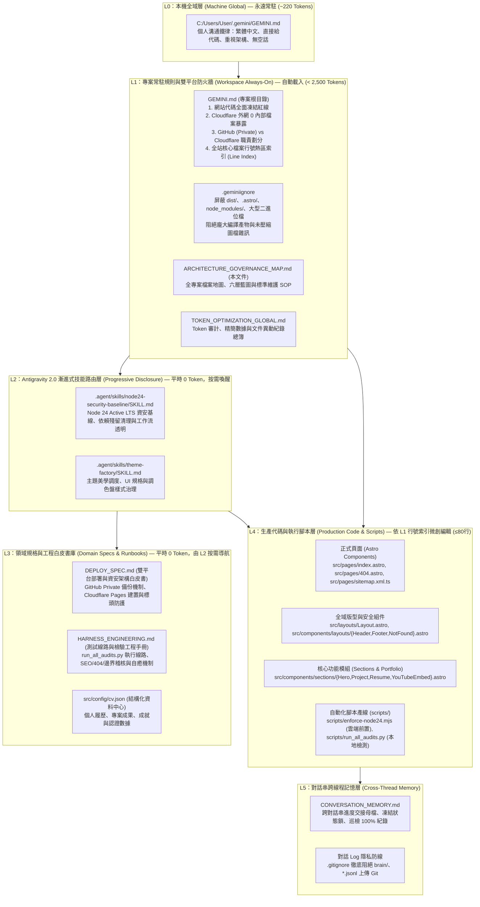
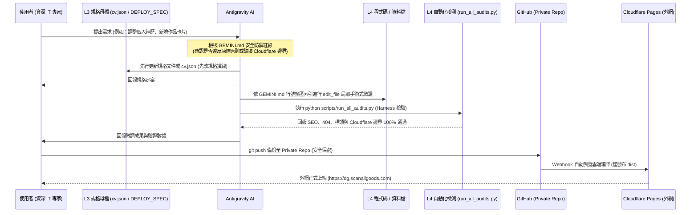

# 全專案文件、規則、技能、腳本與生產架構總體藍圖 (`ARCHITECTURE_GOVERNANCE_MAP.md`)

> **文件位階**：專案最高全域導覽母檔（Project Master Architecture & File Governance Map）  
> **適用標準**：Google Antigravity 2.0 原生客製化規範（`GEMINI.md` 階層規則 + `.agent/skills/` 漸進式揭露）  
> **核心架構**：GitHub (Private Security Zone) ＋ 原環境 GitHub Pages / Netlify (Production Distribution)  
> **連動母檔**：[GEMINI.md](./GEMINI.md) ｜ [DEPLOY_SPEC.md](./DEPLOY_SPEC.md) ｜ [HARNESS_ENGINEERING.md](./HARNESS_ENGINEERING.md) ｜ [TOKEN_OPTIMIZATION_GLOBAL.md](./TOKEN_OPTIMIZATION_GLOBAL.md)  
> **最後更新**：2026-10-29

---

## 一、架構理念：資深 IT 的工程紀律與防禦縱深

本專案為 **Henry Lu (Paul Smith)** 專業個人履歷與作品集網站（`https://dg.scanallgoods.com`）。
專案主持者為資深 IT 專家（CIO/資深架構師），全專案徹底杜絕業餘開發行為，以嚴格的六層架構（L0 → L5）落實「小心翼翼、零機密洩漏、版面代碼凍結、規格優先、雙平台職責分離」之專業精神。

---

## 二、全專案檔案分類與職責清冊

### 1. 【規則、部署與架構類 Rules & Deployment】
| 檔案路徑 | 層級 | Antigravity 載入方式 | 核心職責 |
| :--- | :--- | :--- | :--- |
| `C:\Users\User\.gemini\GEMINI.md` | **L0** | 永遠自動載入 | 個人全域習慣：繁體中文、專家溝通、直接代碼。 |
| [GEMINI.md](./GEMINI.md) | **L1** | **專案常駐載入** | 專案總體規則：代碼凍結、Cloudflare 邊界防火牆、熱區行號索引。 |
| [.geminiignore](./.geminiignore) | **L1** | 搜尋引擎自動過濾 | 隔離 `dist/`、`.astro/`、`node_modules/`，維持超低 Token 消耗。 |
| [ARCHITECTURE_GOVERNANCE_MAP.md](./ARCHITECTURE_GOVERNANCE_MAP.md) | **L1** | 專案導覽母檔 | 本文件，全專案六層架構藍圖、職責矩陣與標準維護程序。 |
| [TOKEN_OPTIMIZATION_GLOBAL.md](./TOKEN_OPTIMIZATION_GLOBAL.md) | **L1** | 治理日誌 | 記錄專案所有文件異動、Token 消耗前後對照與審計。 |
| [DEPLOY_SPEC.md](./DEPLOY_SPEC.md) | **L3** | 部署白皮書 | GitHub Private ＋ 原環境 (GitHub Pages / Netlify) 職責邊界與安全配置。 |
| [HARNESS_ENGINEERING.md](./HARNESS_ENGINEERING.md) | **L3** | 測試工程手冊 | 自動化測試線路、SEO 審核標準、404 安全防禦與邊界滲透檢核。 |
| `netlify.toml` | **L3** | 建置配置 | 鎖定生產環境發布目錄為 `dist` 與 Node 24 執行時期。 |
| `public/_headers` ｜ `_headers` | **L3** | 資安標頭 | OWASP 等級 CSP、Frame-Busting、HSTS 邊緣標頭配置。 |

---

## 二、全專案本地檔案完整盤點表 (Local File Inventory)

本清單全面盤點本機 workspace 中的每一個檔案與目錄，嚴密分層管轄：

| 檔案/目錄路徑 | 類型 | 納入 Git? | 暴露 Cloudflare? | 說明與安全職責 |
| :--- | :---: | :---: | :---: | :--- |
| `.agent/skills/*` | 技能目錄 | 是 | **否 (阻絕)** | 本地 AI 專案技能，僅供本地代理調度，絕不進 dist。 |
| `.github/workflows/deploy.yml` | CI/CD | 是 | **否 (阻絕)** | GitHub Actions 自動化部署工作流（Node 24 基線）。 |
| `.vscode/` | IDE 配置 | **否 (已隔離)** | **否 (阻絕)** | 本機 VS Code 插件與除錯設定，已自 Git 排除。 |
| `.gitignore` | 版本控制 | 是 | **否 (阻絕)** | 國防級隔離規則，徹底阻絕機密與暫存進庫。 |
| `.geminiignore` | Token優化 | 是 | **否 (阻絕)** | 阻止 AI 搜尋引擎檢索編譯產物，降低 Token 消耗。 |
| `.node-version` / `.nvmrc` | 環境鎖定 | 是 | **否 (阻絕)** | 嚴格鎖定 Node.js 24 Active LTS。 |
| `astro.config.mjs` | 專案核心 | 是 | **否 (阻絕)** | Astro 靜態網站整合設定 (Tailwind, Icon, MDX, Sitemap)。 |
| `package.json` / `lock` | 相依管理 | 是 | **否 (阻絕)** | 套件相依與 npm scripts 定義，嚴格管控版本。 |
| `tailwind.config.mjs` | 樣式設定 | 是 | **否 (阻絕)** | Tailwind CSS 樣式與斷點配置。 |
| `tsconfig.json` | TS 設定 | 是 | **否 (阻絕)** | TypeScript 編譯與型別檢查規則。 |
| `public/CNAME` | 網域解析 | 是 | **是 (公開)** | 自訂網域宣告 (`dg.scanallgoods.com`)。 |
| `public/_headers` | 標頭配置 | 是 | **是 (公開)** | Edge 端點安全標頭注入檔。 |
| `public/robots.txt` | 爬蟲協議 | 是 | **是 (公開)** | 搜尋引擎爬蟲路徑指示與 Sitemap 導航。 |
| `public/favicon*` / `apple-*` | 圖示資產 | 是 | **是 (公開)** | 全尺寸網站圖示與行動裝置觸控圖示。 |
| `public/cv/paul_cv.pdf` | 個人簡歷 | 是 | **是 (公開)** | 公開版個人完整履歷 PDF 檔案。 |
| `src/layouts/Layout.astro` | 基礎版型 | 是 | **否 (原始碼)** | 包含 CSP、Frame-Busting 與 GA4 之全站母版。 |
| `src/pages/index.astro` | 網站首頁 | 是 | **否 (原始碼)** | 履歷首頁進入點，編譯為 `dist/index.html`。 |
| `src/pages/404.astro` | 錯誤頁面 | 是 | **否 (原始碼)** | 404 專用進入點，強制 `noindex`，編譯為 `dist/404.html`。 |
| `src/pages/sitemap.xml.ts` | 網站地圖 | 是 | **否 (原始碼)** | 動態產出 `dist/sitemap.xml`。 |
| `src/components/*` | 組件模組 | 是 | **否 (原始碼)** | 頁面局部組件（Header, Footer, NotFound, Hero, etc.）。 |
| `src/config/cv.json` | 資料中心 | 是 | **否 (原始碼)** | 履歷卡片資料庫，編譯時注入靜態 HTML。 |
| `src/assets/*` | 圖檔資源 | 是 | **否 (原始碼)** | 原始照片，由 Astro 優化輸出至 `dist/_astro/*.webp`。 |
| `scripts/enforce-node24.mjs` | 建置前置 | 是 | **否 (內部腳本)** | 雲端/本機建置前執行之 Node 24 驗證腳本。 |
| `scripts/run_all_audits.py` | 自動稽核 | **否 (本機工具)**| **否 (內部腳本)** | 本地五合一全自動巡檢腳本。 |
| `*.bat` (preview/deploy/stop) | 自動化批次| **否 (本機工具)**| **否 (內部腳本)** | 本機維運快速指令腳本。 |
| `dist/` | 編譯產物 | **否 (忽略)** | **100% 公開** | **Cloudflare Pages 唯一發布目錄，純靜態網頁資源**。 |

---

## 三、標準維護作業程序 (SOP)

1. **需求提出**：審核是否符合架構安全原則，確認修改範圍。
2. **規格先行**：先修改 `src/config/cv.json` 或白皮書規格。
3. **熱區定位**：查閱 `GEMINI.md` 第 4 節行號熱區，以 `read_file(≤80行)` 精準定位。
4. **手術微調**：使用 `edit_file` 精準置換，嚴禁整檔覆寫腳本。
5. **程式驗收**：執行 `python scripts/run_all_audits.py`，確保 SEO、AEO、404、Cloudflare 邊界 0 錯誤。
6. **進度記錄**：更新 `TOKEN_OPTIMIZATION_GLOBAL.md` 與 `CONVERSATION_MEMORY.md`。
7. **雙平台發布**：Push 至 GitHub Private，Cloudflare 自動編譯 `dist` 發布全球。
