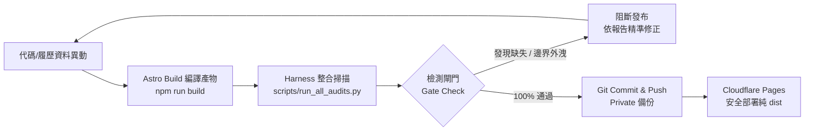

# 專案線路測試、靜態檢測與自癒工程規範 (`HARNESS_ENGINEERING.md`)

> **文件位階**：自動化驗證與軟體工程線路手冊 (L3 Engineering Spec)  
> **連動腳本**：`scripts/run_all_audits.py`  
> **最後更新**：2026-10-29

---

## 一、工程背景：拒絕業餘行為，落實 Harness 軟體工程驗收

在成熟的 IT 系統架構中，任何網站推上生產線前，都必須具備**完整的測試線路（Test Harness）**。
本專案絕不允許「改完 code 就直接 push，結果外網破圖、404 未保護、或內部原始碼遭 Cloudflare 暴露」的非專業行為。所有生產產物皆由本地自動化腳本實施多維度檢測。



---

## 二、第一道檢測線：SEO 關鍵字與 Meta 標籤審核

### 1. 檢驗目標與合格標準
- **掃描範圍**：`dist/index.html`
- **三大檢核維度**：
  1. **Title 標籤**：長度介於 10~70 字元，不可為空或預設樣板字串。
  2. **Description 描述**：長度介於 30~200 字元，精準概括專業經歷與核心價值。
  3. **語系與規範連結**：包含正確 `lang="zh-Hant"` 或多語宣告，以及 Sitemap 索引指向。

---

## 三、第二道檢測線：404 頁面安全隔離與體驗檢核

### 1. 檢驗目標與合格標準
- **掃描範圍**：`dist/404.html`
- **檢驗重點**：
  1. **檔案實體存在性**：編譯後必須確實生成獨立 `dist/404.html`。
  2. **Noindex 安全隔離**：必須包含 `<meta name="robots" content="noindex, nofollow" />`，嚴防搜尋引擎無效抓取。
  3. **友善導航與安全標頭**：具備返回首頁按鈕與 OWASP Frame-Busting 防點擊劫持保護。

---

## 四、第三道檢測線：生產發布邊界審核 (Zero Internal File Leakage - Dist Boundary)

### 1. 檢驗目標與合格標準
- **掃描範圍**：`dist/` 全目錄遞迴掃描
- **核心鐵律**：**外網端點絕對不能出現內部檔案，只能與網頁公開資產有關**。
- **違規阻斷特徵清單 (Blacklist Extension & Filename)**：
  - **原始碼檔案**：`.ts`, `.tsx`, `.astro`, `.mjs`, `.cjs`, `.jsx`, `.vue`
  - **內部腳本與設定**：`.py`, `.bat`, `.sh`, `.ps1`, `.jsonc`, `package.json`, `tsconfig.json`
  - **機密環境變數**：`.env*`, `*.secret`, `*.pem`, `*.key`
  - **對話日誌與 AI 軌跡**：`*.jsonl`, `*.log`, `brain/`, `CONVERSATION_MEMORY.md`
  - **內部專案目錄**：`node_modules/`, `scripts/`, `.agent/`, `.vscode/`, `.git/`

一旦在 `dist/` 中偵測到上述任何檔案，稽核程式將立即中斷並發出 Exit Code 1，強制阻絕發布！

---

## 五、第四道檢測線：邊緣安全標頭合規性審核

### 1. 檢驗目標與合格標準
- **掃描對象**：`dist/_headers` 與 `public/_headers`
- **必備標頭清單**：
  - `X-Frame-Options: SAMEORIGIN`
  - `Content-Security-Policy`
  - `X-Content-Type-Options: nosniff`
  - `Referrer-Policy: strict-origin-when-cross-origin`
  - `Permissions-Policy`
  - `Strict-Transport-Security`

---

## 六、第五道檢測線：靜態資源完整度與 404 壞軌查核

### 1. 檢驗目標與合格標準
- **掃描對象**：`dist/index.html` 與 `dist/404.html`
- **檢核重點**：
  - 解析 HTML 內部引入之 CSS、JS、WebP 圖檔、Favicon、PDF 等資源路徑。
  - 逐一驗證本機檔案系統存在性，杜絕 404 資源壞軌。

---

## 七、一鍵執行與自癒程序

在終端機中僅需一行指令即可完成整套線路測試：

```bash
python scripts/run_all_audits.py
```

### 檢驗回傳代碼標準：
- **Exit Code 0**：全站 100% 通過，各項指標符合資深 IT 架構規範，可安全執行 `git push`。
- **Exit Code 1**：發現壞軌、遺失資產、404 缺失、或 Cloudflare 邊界滲漏，終端機立即中斷並輸出具體檔案供排查。
